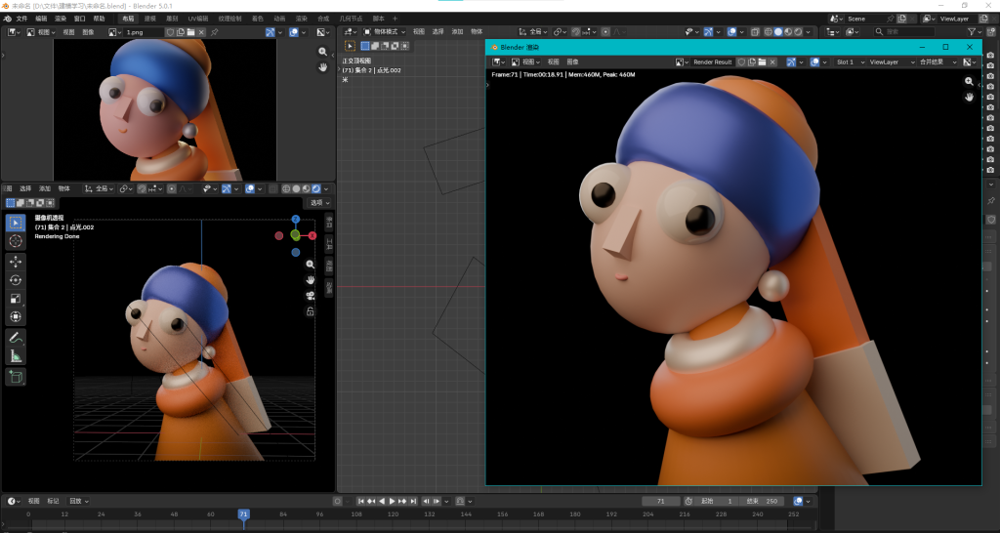
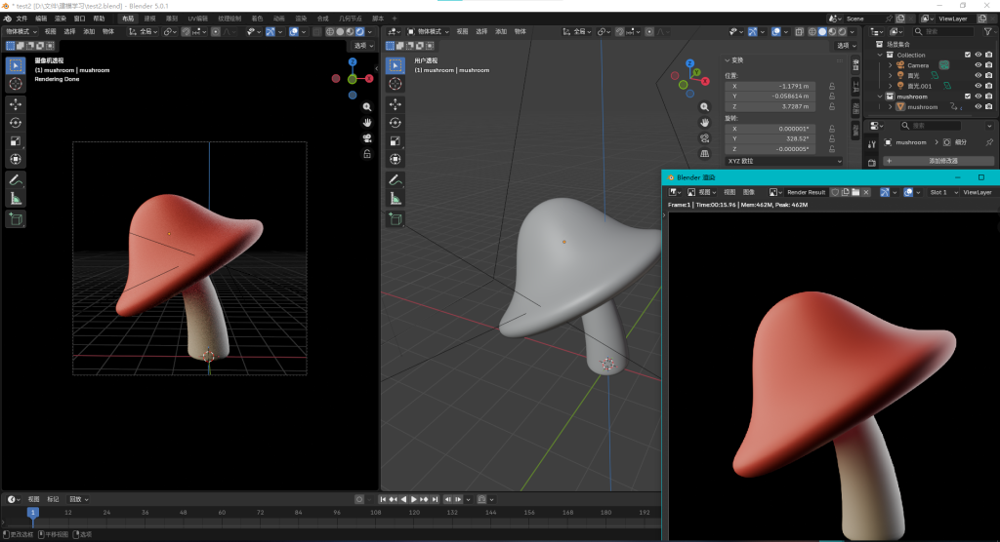
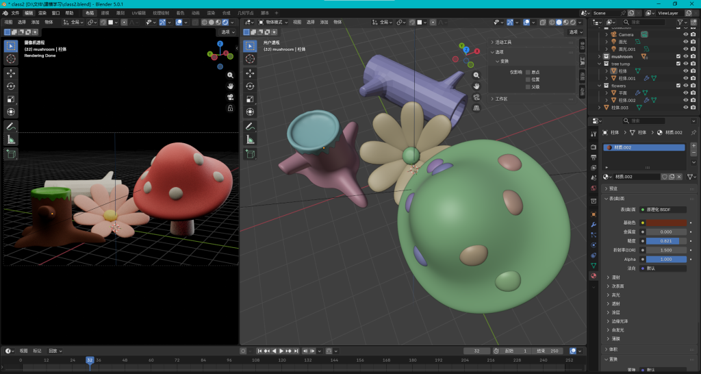
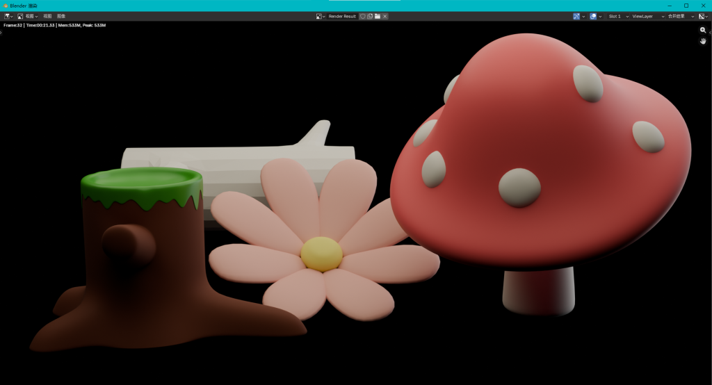
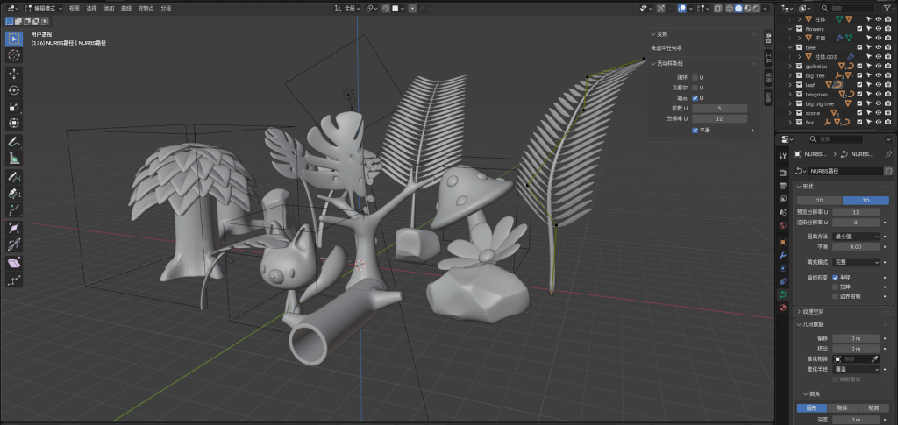
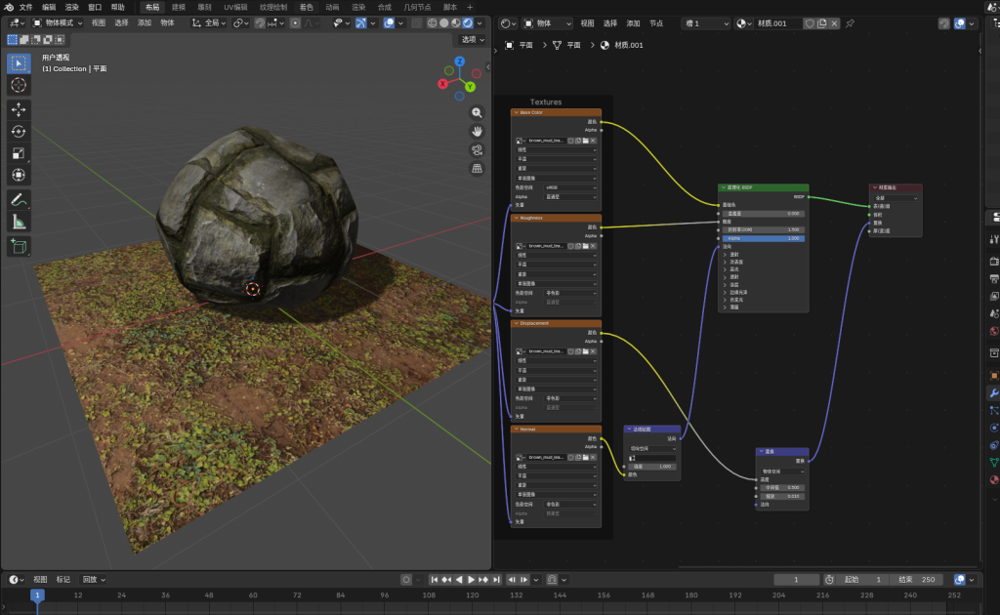

**前言
**年后在家里闲着没事，家里又刚好买了一套新房，不过装修要等到今年年尾了，想提前设计一下新家的布局，也打发一下时间，于是便试着学一下blender，记录一下学习过程，看看在七天之内能够学到什么水平。

* * *

**第一天**

去官网下载了[blender](https://www.blender.org/)

在b站找了一个教程：
[【【Kurt】Blender零基础入门教程 | Blender中文区新手必刷教程(已完结)】](https://www.bilibili.com/video/BV14u41147YH/?p=5&share_source=copy_web&vd_source=e74844bec5b370e6c0abb37bc15e38)

个人体感来说，难度适宜，讲得比较详细，不拖沓，很干。不赖，是上好的东西。

看完了的第一章《基础篇》熟悉了一下界面和各种快捷键，了解了一下一个3d项目的工作流，建模，布光，材质，渲染。刚接触的新鲜劲比较足，大概学了5个小时，跟着视频做了一个经典模型“戴珍珠耳环的少女”

虽然就导出效果而言并不“少女”，但是还是蛮有成就感的。

* * *

**第二天**

跟着教程进入了第二章，相对上一章来说，干货更干，节奏更快一些。

如果说上一章实现一个模型的方法是搭积木的话，这一章则是雕刻石膏了。

上一章是将基础模型拉伸，放大缩小，旋转，组合成目标事物，这一章则是直接在基础模型上动刀，让它变成想要的样子。操作量更大了，需要积累的思路和手法以及要注意的细节都更多了。今天大概学了3个小时，做了一个蘑菇模型。

* * *

**第三天**

今天由于生活中的琐事太多，只学了两个小时不到。第二章相关的操作和知识点相当的多且琐碎，学起来比较容易疲惫，拼尽全力无法战胜第二章😥。

今天的成果是跟着教程又做了几个建模，更多的是在练手和记一些比较碎片化的操作。总体来说在整个blender框架的思想上，没有太多的收获，更多是在练基本功。

* * *

**第四天：**

戴森球真好玩🥴

* * *

**第五天：**

依旧练习建模ing~

* * *

**第六天：**

跟着教程将所有的模型都完整做了一遍，真如第二章中的某一p标题所言“建模马拉松”，过程的确和马拉松一样，艰难且漫长。

当新鲜感褪去，面对更加复杂和庞杂的知识，获得感一点点下降，无聊一点点增多，在过程会遇到因为一个操作的不对来回琢磨数小时的情况，的确会消磨我的兴趣。当坚持下来跑完整个“马拉松”，回看自己一个个亲手做好的模型，还是会有相当的成就感的。

整个建模篇学下来，收获还是很大的。

面对如何从零开始搭建一个简单的模型已经有了一个清晰的概念，对于常用的建模工具和手段也有了一些基本的了解。

我已经是blender高手了😋！（不是

* * *

**第七天：**

大概将建模篇学了一半，操作复杂度相对前一章减少了很多，没有太多能够量化的东西，更多的是靠自己去一个个的调整参数，找感觉。

感觉blender中着色编辑器的面板和comfyui的操作面板很像，问了一下Gemini，其逻辑叫”基于节点的视觉编程”，是一种非破坏性编辑。体验下来是一种相当直观且好用的编辑方式。

* * *
