-   前言：最近在黑盒刷到一篇关于将deepseek接入微信的帖子，加之最近对deepseek的使用频率确实不小，便打算尝试将deepseek接入微信，便有了这篇帖子

前期准备：

1.两个微信号（大小号）

2.python（3.8以上）

3.deepseek的api：官方：[DeepSeek 开放平台](https://platform.deepseek.com/usage)，硅基流动（免费15块额度）:[SiliconCloud](https://cloud.siliconflow.cn/models)

4.WeChatBot：项目网址：[Release WeChatBot\_WXAUTO\_SE\_v3.8 · KouriChat/WeChatBot\_WXAUTO\_SE](https://github.com/KouriChat/WeChatBot_WXAUTO_SE/releases/tag/3.8)

* * *

**第一步（微信注册省略）python的安装：**

点击下面网址👇

[python-release-windows安装包下载\_开源镜像站-阿里云](https://mirrors.aliyun.com/python-release/windows/?spm=a2c6h.25603864.0.0.9bbb641477vZeG)

下滑找到这个文件，点击下载

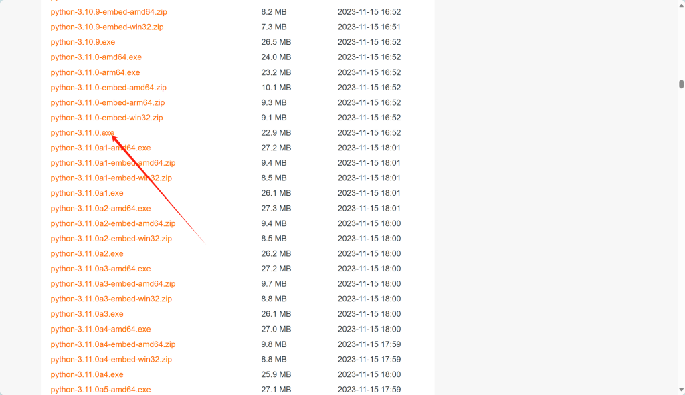

打开文件，安装

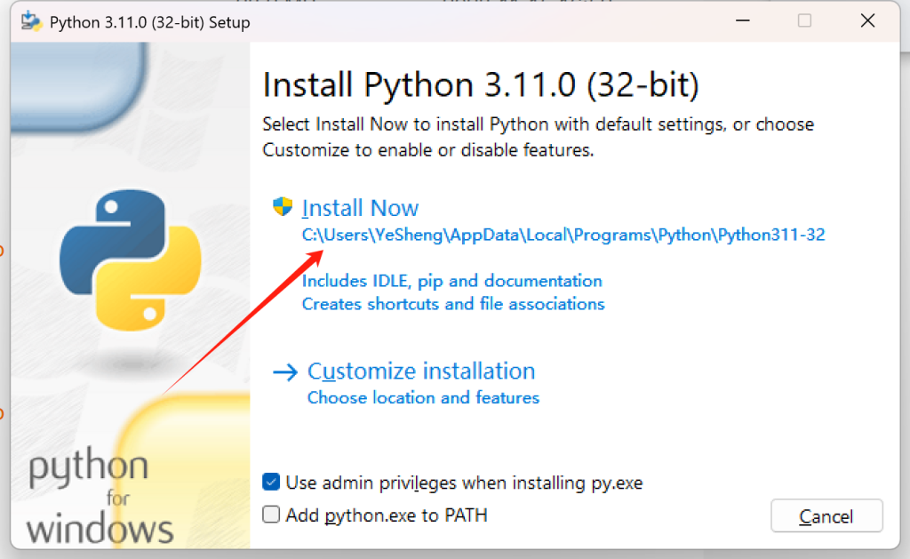

这样python的安装就完成了！

那有人就要问了，主播，主播这样的python安装还是太吃操作了，有没有更简单的方法。

有的，兄弟有的

只需要同时按下win+Q键，搜索Microsoft Store

然后搜索python，安装3.12以下的版本就行了

* * *

**步骤二，api的获取：**

上述前期准备一栏中给出了两个网址，个人建议用硅基的，其一是有免费的15元额度（可以用很久了），其二在实际使用中稳定性相比于官方的api更好。下文将分别叙述两种api的获取方式：

**官方：**

点击👉[DeepSeek 开放平台](https://platform.deepseek.com/usage)

登录完成后，进入个人信息页面，完成实名认证（否则用不了）

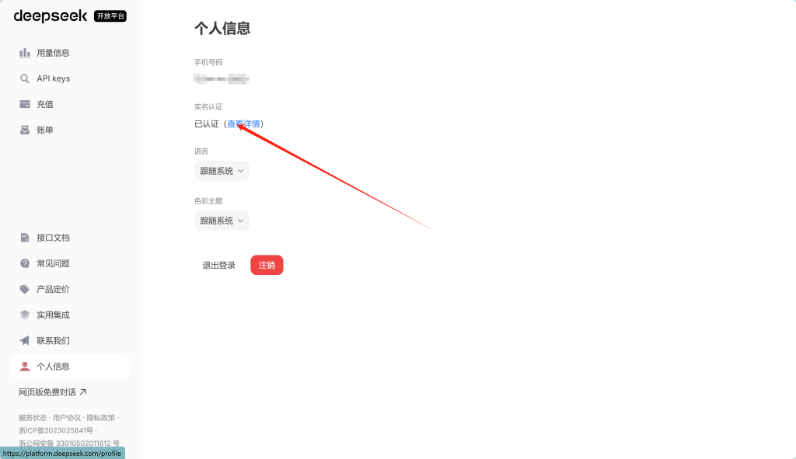

实名认证完成后，进入API keys页面，

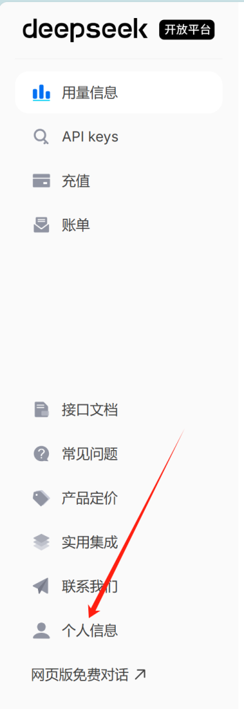

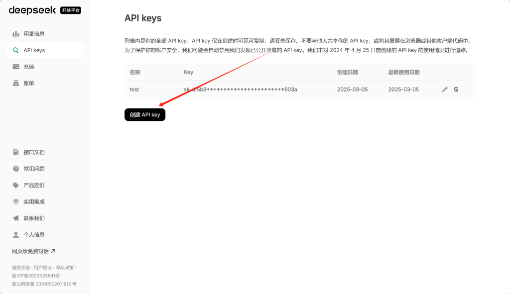

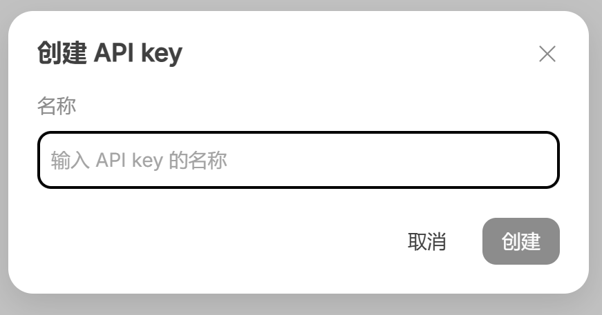

名字随意，你喜欢就好

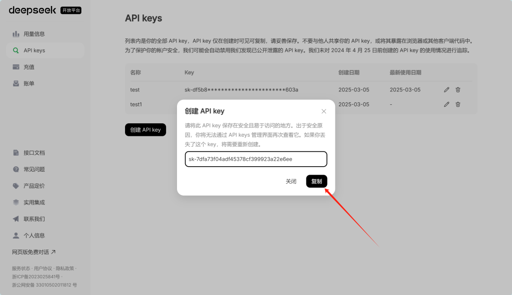

将这串神秘代码保存好，并确保不要泄漏到公共网络（这是接下来要用的神奇妙妙工具.jpg）。

**硅基流动;**

点击👉[SiliconCloud](https://cloud.siliconflow.cn/models)

完成登录后，同样是先进行实名认证

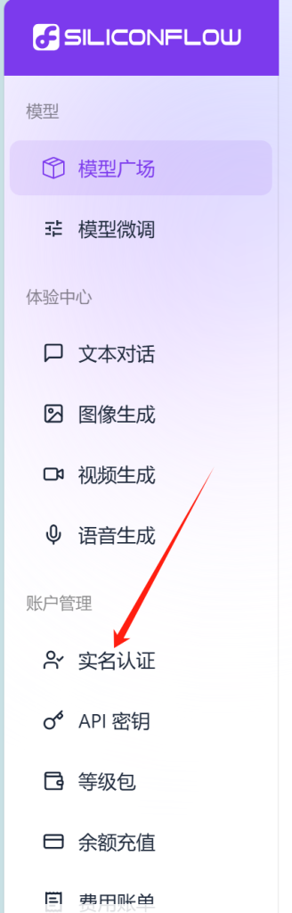

实名完成后进入API密钥页面，获取api

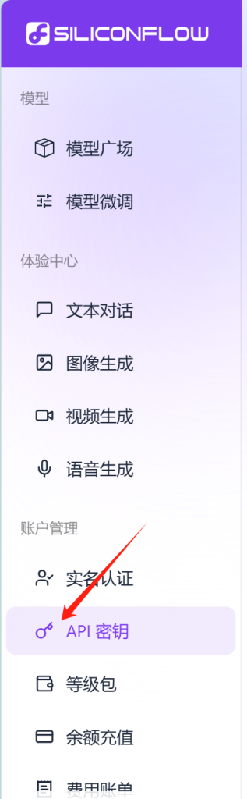

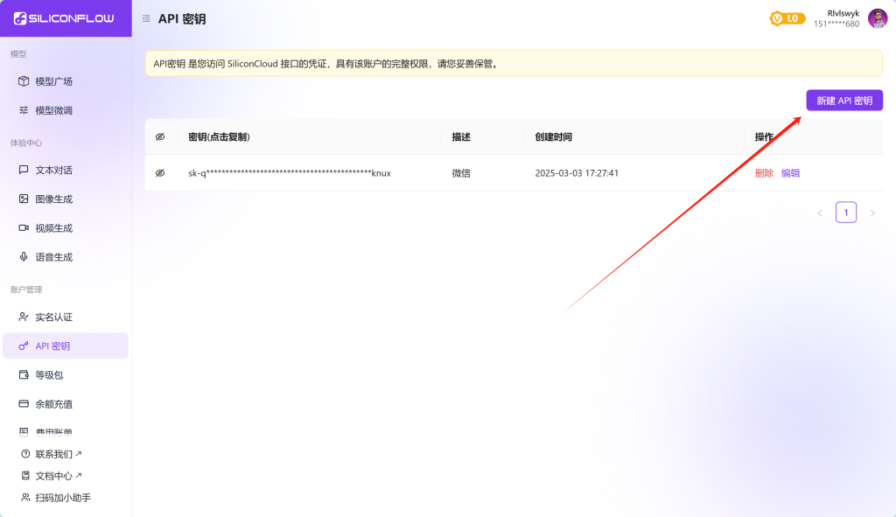

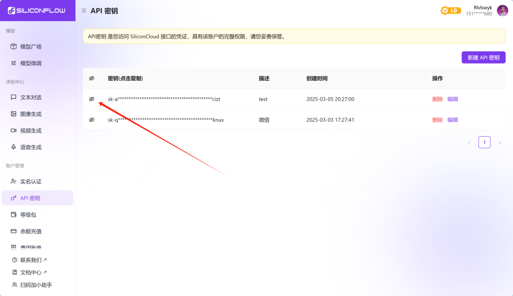

点击这里复制粘贴保存下来即可。

* * *

**第三步，WeChatBot的安装：**

点击👉[Release WeChatBot\_WXAUTO\_SE\_v3.8 · KouriChat/WeChatBot\_WXAUTO\_SE](https://github.com/KouriChat/WeChatBot_WXAUTO_SE/releases/tag/3.8)

选择zip下载

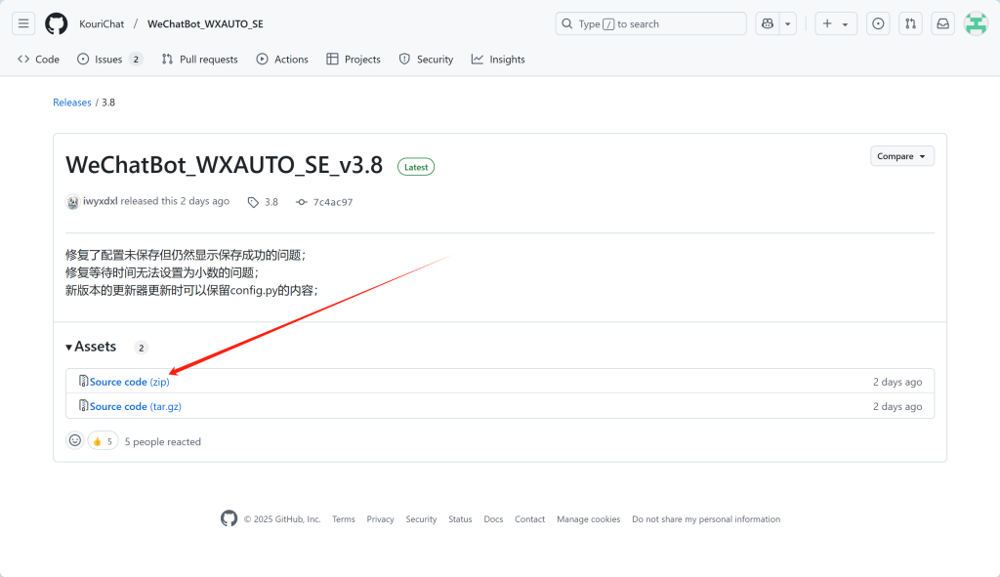

下载解压缩之后点击这里，Run

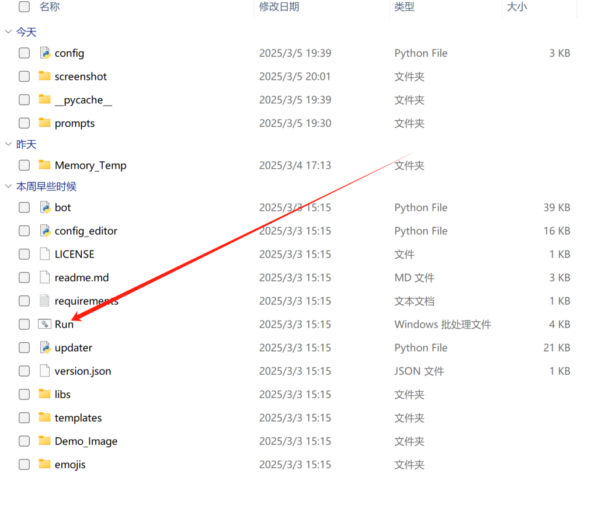

等待软件安装完成，当浏览器打开这个页面之后

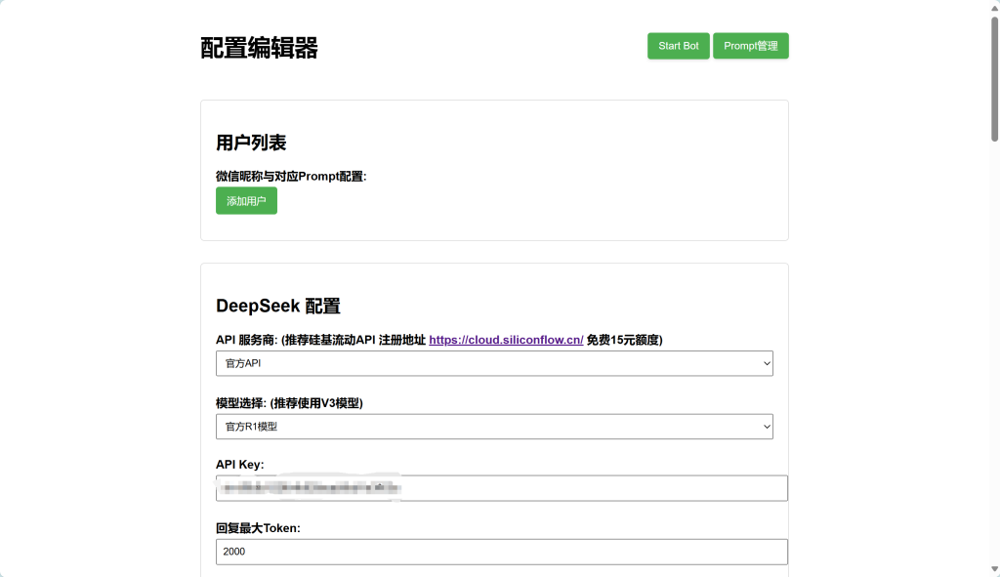

那么前期的所有准备都完成了，现在离和ai对话只差临门一脚了。

**步骤四，ai的配置：**

接下来我将简单介绍如何配置一个符合自己需求的ai

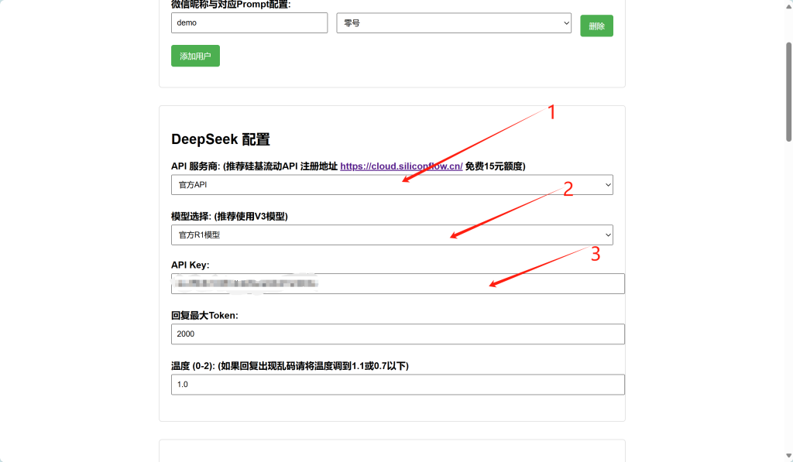

1.选择你的api服务商，如果在上述步骤二中获取的api是官方的就选择官方api，如果是硅基的就选择硅基。

2.选择ai的模型，根据自己的需求选择适合的模型。

3.将上述步骤二中获取的apikey复制到这里。

完成上述步骤后，接下来为ai创建一个自己喜欢的人设吧！

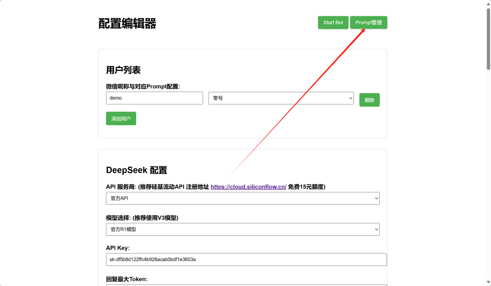

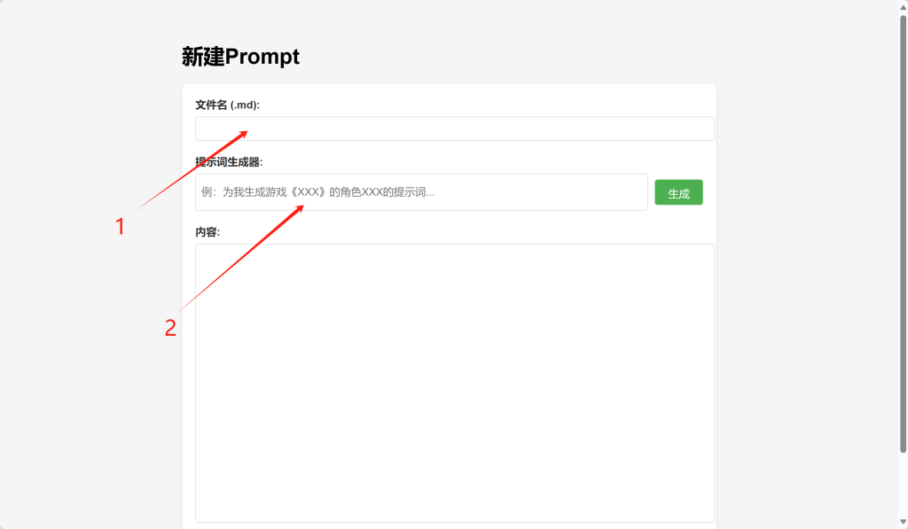

1.可以理解为这个人设的名字

2.根据你的爱好和需求输入，你想要ai扮演一个什么样的角色，ai会自动生成详细的描述词在下方的内容栏里。（如果觉得不满意可以在内容栏里做一些修改）

当完成上述操作后，

1.填写你的微信大号名称。

2.选择你想要的人设。

**3.聊天机器人，启↘动↗！！**

* * *

通过上述的操作你就可以得到一个简单的聊天机器人了，配置界面中还有一些功能就留给你自己探索了（绝不是我太懒不想写了，大概）。

本篇使用攻略是本人操作中的总结，如有错误，欢迎指正。

——The End
