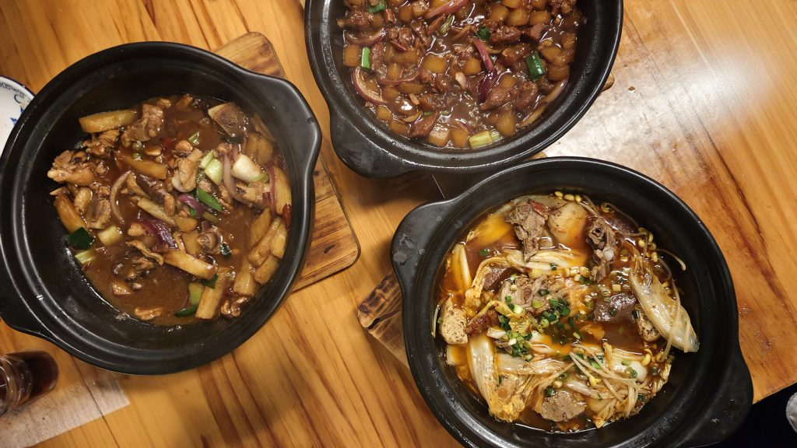
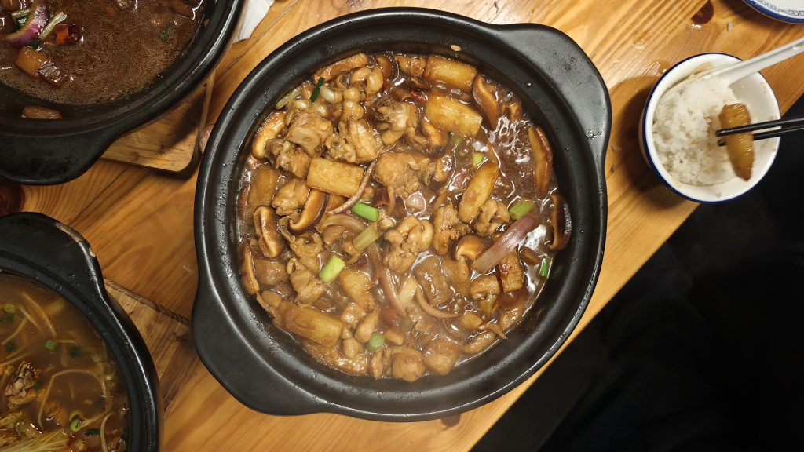

<iframe src="https://music.163.com/outchain/player?type=2&id=1456890009&auto=1&height=66" width="330" height="86" loading="lazy" title="音乐播放器"></iframe>

鸡煲，全名重庆鸡公煲，校外的一间普通小店。

3月9号，一个稀松平常的下午，鸡煲的门头贴上了一张鲜红的旺铺出租，里面空无一物。鸡煲倒闭了。

鸡煲是什么时候走的呢？我不得而知，像青春里略带缺憾的感情，没有华丽的开头，没有正式的告别，在不经意间不辞而别了。

我向来不喜欢出校门，太远，太麻烦，出校门吃饭就更不喜欢了。不出意外的话，我和鸡煲应该没有任何交集。某天，几个朋友说外面有家餐馆还不错，一向不爱出门的我，像受到了某种神启，稀里糊涂的坐在了鸡煲的廉价木凳子上。

那是我们第一次见面。

具体点了些什么菜已经忘记了，只是那次之后，我出门吃饭次数多了起来，也去其他的餐馆，但去的最多，还是鸡煲。不知不觉中，我开始习惯去鸡煲吃饭，习惯在进门右手边第一张桌子的第一个凳子坐下，点上一份鸡煲，渐渐成为了鸡煲里那个会定期刷新的npc。

现在想来，鸡煲也没有那么好吃，它的卖相不算精致，不是那种能出片的漂亮饭，它的油很多，盐很重，辣椒很辣，吃多了会腻，不太健康。它和大学门口大多数餐馆并没有太多区别，都只是价格不算贵，味道上过得去，没什么特别。或许只是恰巧那段时间我寡淡的生活需要一个东西调剂，又恰巧鸡煲进入了我的视野，便迷恋上了鸡煲，就这么回事，谈不上轰轰烈烈。世界上大多数遇见都是如此，你恰巧需要一些东西的时候，他恰好有。

鸡煲离开的理由，想来和其他餐馆没什么不同，不酷，不浪漫，不热烈，无外乎几个：租金上涨，顾客寥寥，老板太累，总之，赚不到钱。

当它触手可及时，我总是选择性忽略。前几天想去吃鸡煲，但转念一想，觉得鸡煲的油太多，太腻，太辣，太不健康，便没了胃口，想着过段时间再去。可今天晚上躺在床上，不知怎的，突然好想好想吃鸡煲，想念它热腾腾的鸡公煲，想念它咸甜的萝卜牛腩，想念它麻辣的冒烤鸭。

我从没有如此想念一家餐馆，为什么呢？我想不出答案。

我突然开始后悔起来，后悔没有多吃几次鸡煲，后悔在办活动的时候没有去，后悔我没有一个大卫戴。

我开始妄想，妄想自己有一个大卫戴，当时鸡煲还在的时候，就能多点几个菜，鸡煲就能多赚点马内，或许鸡煲就不会离开。可又我清楚的知道，即便我有味真族族长良子的大卫戴，一顿能猛造一万大卡，也于事无补，世上有些事的结果是不因个人行为而改变的，鸡煲的离开是其中之一。

飞鸟与鱼不同路，我不是味真族良子，鸡煲也不是驴肉味焖子。从此山水不相逢，我想，我和鸡煲的缘分已经尽了。

不久后，鸡煲的位置会重新开一家餐馆，或许也卖鸡公煲，或许我也会光顾，或许也会成为那里的常客，但那终究不是我认识的那个鸡煲。鸡煲或许会在新的城市落脚，那个城市也会有人痴迷鸡煲的味道，成为鸡煲的常客。

我和鸡煲都将开启一段新的旅程，最终，我们都变成了彼此经历中的一个小小注脚。

或许在很久很久以后的将来，我踏进一家陌生的餐馆，鬼使神差下，我点了一份鸡公煲，夹起一块，熟悉咸辣的味道在口腔炸开，我大概会发愣几秒，然后笑笑。

结账，走人。

**——The End——**

* * *

**后记：**

附几张鸡煲照片

