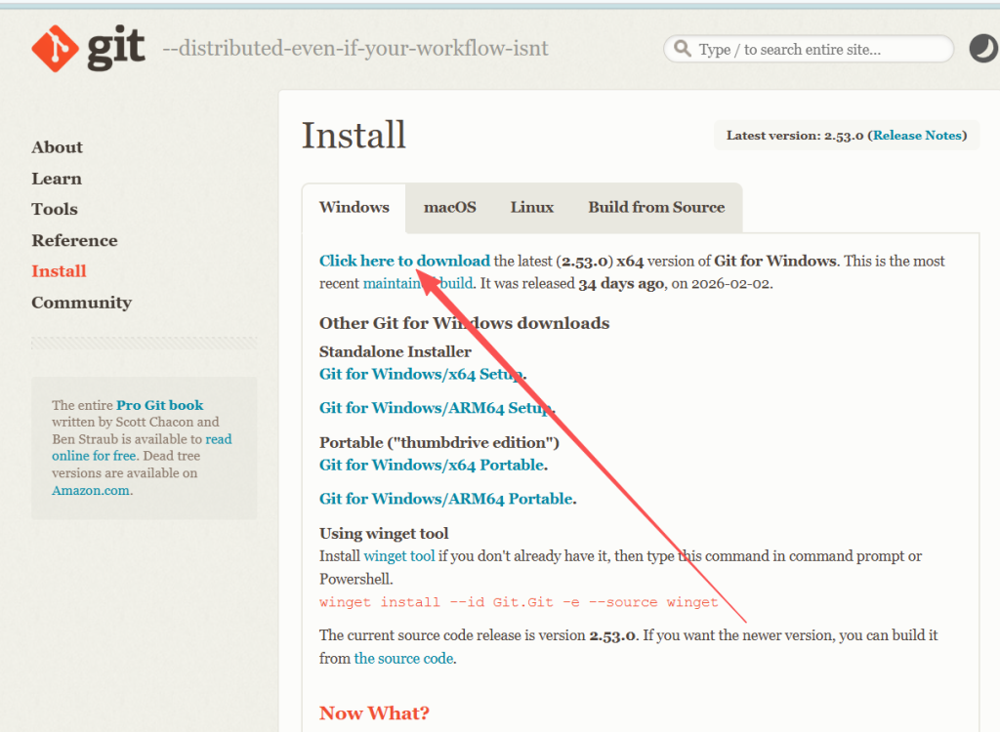
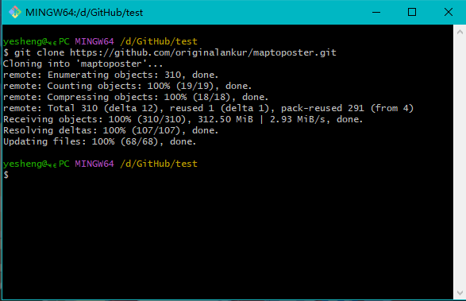
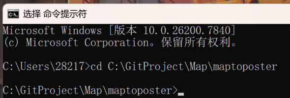
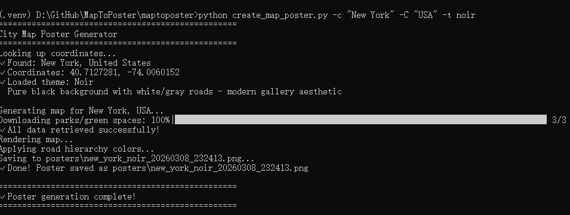
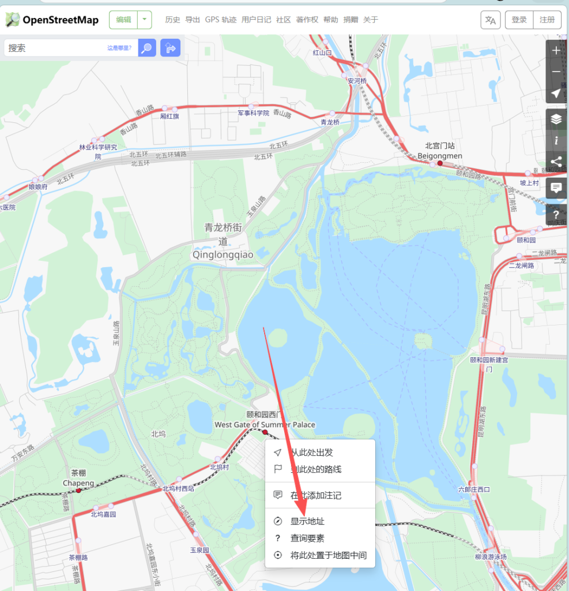

**前言：**

该项目可以通过自定义，来生成不同大小，经纬度和不同风格城市壁纸，调整不同的参数来一键生成一张炫酷的城市壁纸。

* * *

准备：[git](https://git-scm.com/install/windows)，[github](https://github.com/)，python

**第一步：前期准备**

1.安装git，方便后续将项目克隆到本地，进入官网下载git

安装过程略，一直选择下一步就可以，安装完成之后右键鼠标右键会多出两个选项：Open Git GUI here/Open Git Bash here

2.安装python，程序运行需要python环境

直接在系统自带的Microsoft store中搜索python安装即可

* * *

**第二步，将项目通过git克隆到本地，并安装项目所需要的依赖**

1.新建一个git仓库，并将项目克隆到本地（如果下载过慢请自行使用”魔法“）
`git clone https://github.com/originalankur/maptoposter.git`

2.创建虚拟环境并安装依赖

打开命令提示符（cmd），移动到项目所在位置
`cd 你对应的项目路径`

创建虚拟环境并激活
`python -m venv .venv   .venv\Scripts\activate`
如果使用 Mac/Linux 系统，激活命令可改为：
`source .venv/bin/activate`
安装依赖项
`pip install -r requirements.txt`

到这一步，恭喜你已经完成了全部的部署工作，可以开始自定义你喜欢的壁纸了！

* * *

**第三步：了解MapToPoster的相关操作**

1.先用一个最简单的指令来试试程序是否能够正常运行吧😋
`python create_map_poster.py -c "New York" -C "USA" -t noir`

生成好的图片会保存到项目的posters文件夹里，在程序安装好后会预先生成一些壁纸

这样一张简单城市壁纸就生成好了！

2.一些简单的命令说明（以生成一张北京的城市壁纸为例）

首先，可以用`-c（小写，代表城市） "Beijing" -C（大写，代表国家）"China"`，来生成指定的城市。

如果想要自定义生成出的图片上的文字可以在通过在后面添加 `-dc "北京" -dC "中国"`。

如果要指定主题，可以通过`-t forest` 来实现，可以通过`--list-theme`查看所有主题，主题的具体效果可以参照[项目地址](https://github.com/originalankur/maptoposter)。

如果要指定大小，可以通过`-W -H` 来实现，单位是英寸（300dpi）所以如果想生成一张1920\*1080分辨率的壁纸，参数应为`-W 6.4 -H 3.6`。

可以用`-d` 来指定生成地图的范围，如`-d 50000` 即中心点向往辐射50km。

可以使用`-lat -long` 来控制中心点的经纬度 `-lat` 代表纬度，`-long` 代表经度，可以通过[OpenStreeMap](https://www.openstreetmap.org/)（也是本程序的数据来源）来查看某个点的具体经纬度

在地图上右键想要查看的点即可获得该点的坐标（39.98409, 116.25715）。

将上述例子中的所有命令组合起来就是：
`python create_map_poster.py -c "Beijing" -C "China" -dc "北京" -dC "中国" -t forest -W 6.4 -H 3.6 -d 50000 -lat 39.98409 -long 116.25715 --font-family "Noto Sans SC"`

上述是生成的图片的效果，试试自己上手生成一张你喜欢的海报吧。

* * *

关于maptoposter的分享内容就到此为止了，希望你能看得开心ヾ(•ω•\`)o，如有错误欢迎指正
**——The End**
