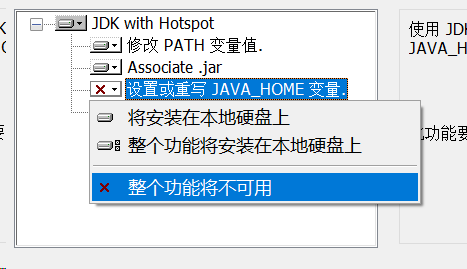
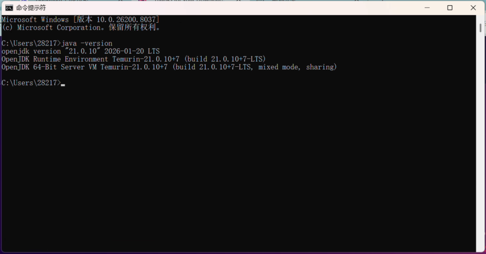
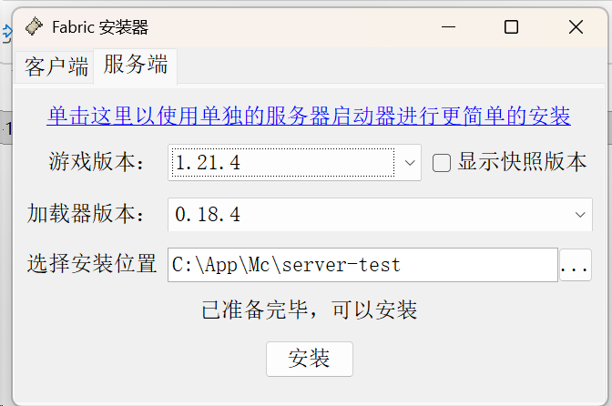
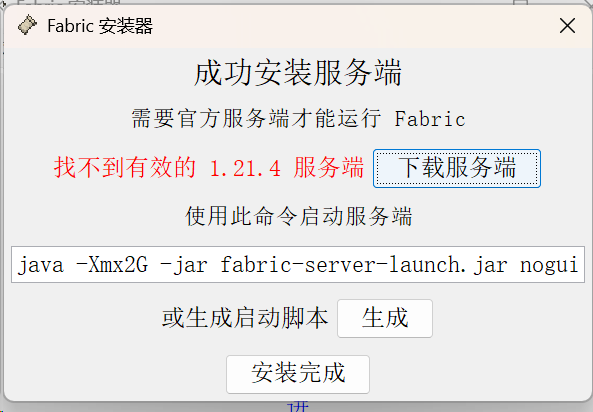
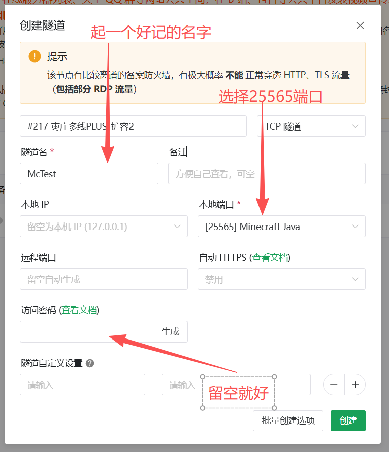
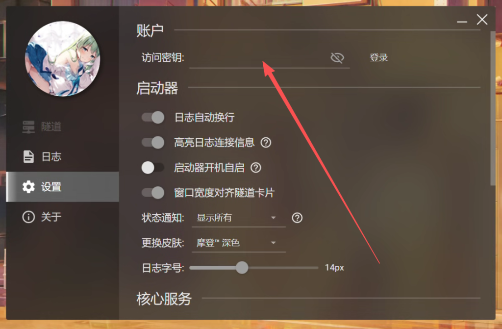
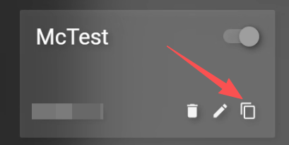

**前言：**

本篇文章旨在用尽量简单且低成本的方法让Mc服务器迅速的跑起来，不会涉及一些比较复杂的东西（~~主要是我也不会~~），所以大可不必有负担。考虑到大部分人并没有一个公网ip，所以本篇文章将使用frp（内网穿透）解决这个问题。

搭建一个Mc服务器需要三个最核心的东西：

Java环境，服务端内核，让别人能够访问自己服务器的方式（公网ip/frp）

也就是说，只要搭建上述三个东西，就能将一台Mc服务器跑起来了，那么接下来就让我们一步步搭建好这三个东西吧。

* * *

**一，Java环境**

Java环境是Mc游戏运行的基础，像天空之于飞鸟，溪水之于游鱼，没有Java环境，Mc游戏本体是无法运行的

请根据不同的游戏版本来选择不同的Java版本

Minecraft 1.20.5 以上： 安装 Java 21

Minecraft 1.18 — 1.20.4： 安装 Java 17

本次演示的版本为1.21.4，故安装Java21

进入**[Adoptium](https://adoptium.net/zh-CN/temurin/releases?version=21&os=any&arch=any)**进行下载
安装过程略，唯一需要注意的是，在这一步中，将第三项改成”将安装在本地硬盘上“，此操作能省去一些配置环境变量的操作，确保安装程序自动帮你把 Java 添加到系统环境变量（PATH）中，这样系统才能识别到Java命令。

安装完成后，使用win+r键，输入cmd，打开命令提示符，输入：`java -version`

如果能够正确的输出Java的版本号，说明Java的安装已经成功了。

**二，服务端内核**

服务端内核就是mc服务器的本体了，不同的内核的侧重点不同。下文我将用fabric进行演示

进入[fabric官网](https://fabricmc.net/use/installer/)进行下载，下载过程略

因为要搭建的是服务器，所以选择服务端，选择对应的版本安装即可。

安装完成后会提示找不到有效的服务端，选择下载即可。下载完服务器后，点击下面的”生成启动脚本“的生成按钮。会自动生成一个启动脚本start.bat，这就是以后服务器的启动按钮。

接下来运行文件夹中的start.bat文件，运行完成之后会生成一大堆文件，暂时先不用管，找到eula.txt文件，打开编辑。将其中eula=false改成eula=true。eula.txt是Mojang的最终用户许可协议，第一次开服必定会生成并导致服务端停止，同意即可。

接下来再次运行start.bat文件，当控制台输出`Done (10.120s)! For help, type "help"`时，标志着服务器已经开始运行了，此时已经可以在内网中访问到这个服务器了。尝试在游戏的多人联机地址中输入 127.0.0.1 或 localhost ，就可以进入刚搭建好的服务器了。

**三，内网穿透（frp）**

因为一些原因，别人并不能直接访问到刚刚搭建好的本地服务器，这时候就需要通过内网穿透来让别人在千里之外访问到本地的Mc服务器。~~达到海内存知己，天涯若比邻的效果~~

内网穿透的方式有很多，这里用[SakuraFrp](https://www.natfrp.com/)演示，樱花frp会提供免费内网穿透服务，通过每日签到可获得免费的流量，足够一个小型服务器使用了。

进入官网，注册账号，进入管理面板。在导航栏中选择服务→隧道列表，点击按钮创建一条新的隧道。选择一个离本地服务器近一点的地区创建隧道，协议选择tcp，剩下的如图。

点击服务→软件下载，下载樱花frp客户端，安装过程略。

点击用户→用户信息，找到右下角的访问密匙，复制。

填写到客户端的访问密匙中，进行登录。

之后，在客户端的隧道页面中找到刚才新建的隧道名称，点击开启，这样就完成了Mc服务器的内网穿透。接下来点击右下角的复制按钮，这个就是Mc服务器的地址了，将这个地址发送给朋友，朋友就可以通过这个地址进入了你服务器游玩了。

以上，你已经完成了Java环境的配置，Mc服务端的部署，内网穿透，成功的搭建了一个Mc服务器了。但想要更好的游戏体验，还需要对Mc服务器文件有一些简单的认识。

接下来，我会简单介绍Mc服务端的一些重要文件。

* * *

**start.bat，这是服务器的启动脚本。**

你可以通过记事本来编辑它。

调整参数，来为服务器分配内存，如`java -Xms4G -Xmx8G`，就是为服务器分配了一个范围为4g-8g的内存。

同时，你也可以通过配置启动参数来进一步优化服务器性能，具体可参考：[Yukiriri/OMCF: Optimal Minecraft Flags. 最优MC运行参数。](https://github.com/Yukiriri/OMCF)，选择适合服务器的参数，添加到 `-jar fabric-server-launch.jar nogui`代码段的前方。

**server.properties，这是整个服务端最核心的配置文件。**

你可以用记事本直接打开它，里面有很多可以自定义的选项。这里挑几个最常用的来说：

`online-mode=true`：正版验证开关。如果你的朋友们没有购买正版 Minecraft，你需要将其修改为 false，否则他们将无法进入服务器。

`spawn-protection=0`：出生点保护范围。 默认值通常是 16，会导致普通玩家在出生点附近无法破坏和放置方块。设置为 0，大家一出生就能立刻愉快地撸树了。

`view-distance=12`：视距。数值越大，玩家能看越远，但服务端的网络带宽和内存压力会呈指数级上升，需要根据具体情况进行加减。

white-list=false：白名单开关。如果你只想让认识的朋友进来，可以把它改成
true，配合后面的whitelist.json使用。

**除此之外**，服务端目录下还有几个比较重要的文件夹和文件：

**mods 文件夹：**

这里是存放各种模组（Mod）的地方。需要注意的是，服务端只需要安装“服务端模组”（比如一些优化模组或改变游戏规则的模组），不需要安装像小地图、光影前置这种纯客户端模组。

**world 文件夹：**

这是你的服务器存档文件。你在游戏里建造的房子、挖的矿都在这里面。如果你要备份服务器，或者想把单人存档搬到服务器里，操作的就是这个文件夹。

**ops.json 与 whitelist.json：**

前者用来存放管理员（OP）名单，后者用来存放白名单玩家。不过一般来说，我们更习惯在运行着服务端的控制台里直接输入指令来添加，比如输入 op 你的游戏ID 就能给自己管理员权限。

上述就是关于Mc服务器文件的一些简单介绍了，祝你和你的朋友能够玩得开心ヾ(•ω•\`)o！

* * *

因为本人也刚接触mc服务器不久，有没讲到的地方或是讲错的地方，希望大佬能够指正，多多包涵！

最后，感谢你的阅读！

**——The End——**
